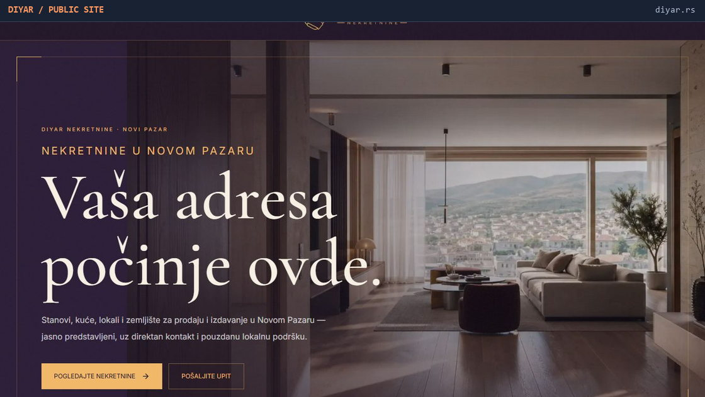
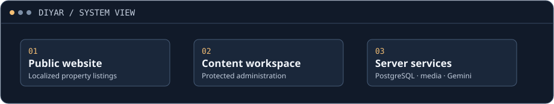

# DIYAR

**Real-estate website · Independent client delivery**

A public website for exploring properties for sale and rent in Novi Pazar, paired with an administrative workspace for maintaining listings and content.

[Visit the client website ↗](https://diyar.rs/) · [Engineering notes](docs/engineering-notes.md)

<picture>
  <source media="(max-width: 560px)" srcset="assets/public-site-mobile.jpg">
  
</picture>

## What I delivered

- **Product and design:** client communication, prototyping, brand identity, and original interface design.
- **Public experience:** localized property listings, listing details, and enquiry entry points.
- **Content operations:** a separate administrative workspace for listings, media and site content, with Gemini-assisted translation.

## How it fits together

<picture>
  <source media="(max-width: 560px)" srcset="assets/system-view-mobile.svg">
  
</picture>

**Next.js · TypeScript · Drizzle ORM · PostgreSQL · Gemini**

The public site is the best way to see the delivered interface. This case study uses the approved public homepage screenshots. Application source, administration screens, and client operations are kept private.
